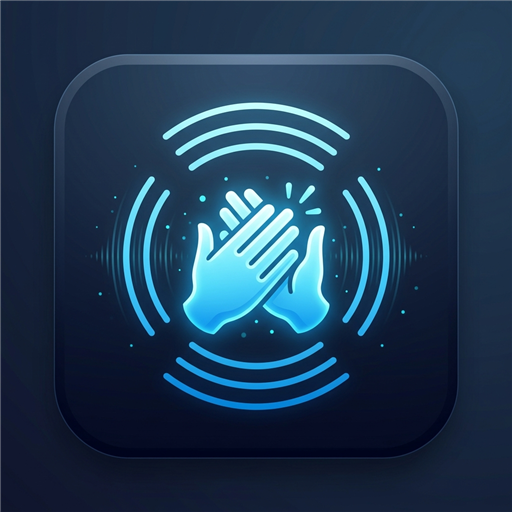
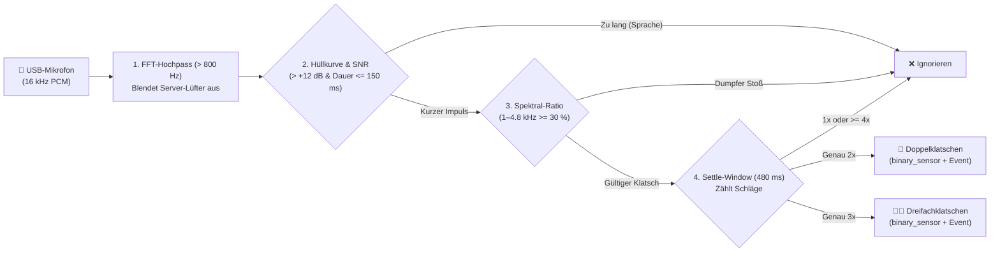

<div align="center">



# 👏 Home Assistant Clap Sensor
**Fehlalarmresistente Doppel- & Dreifachklatsch-Erkennung über jedes USB-Mikrofon (z. B. alte USB-Webcam am Proxmox-Server)**

[](https://github.com/hacs/integration)
[](https://github.com/Raeumlichkeit/ha-clap-sensor/releases)
[](https://www.home-assistant.io/)
[](test_detector.py)

[**🚀 Installation über HACS**](#-1-installation-%C3%BCber-hacs-empfohlen) •
[**📦 Installation als HA-Add-on**](#-2-optional-installation-als-home-assistant-add-on) •
[**🔌 Proxmox USB-Passthrough**](#-3-usb-webcam-in-proxmox-durchreichen) •
[**⚡ Automationen**](#-4-automationen--entit%C3%A4ten)

</div>

---

## ✨ Highlights & Features

Klassische Klatschschalter scheitern im Alltag oft daran, dass sie nur auf einen simplen Lautstärke-Schwellenwert prüfen – dadurch lösen Türenschlagen, Gespräche oder Schritte Fehlalarme aus, während Server-Lüfterrauschen echte Klatscher verschluckt.

**Clap Sensor** nutzt eine mehrstufige **Echtzeit-DSP- & FFT-Pipeline (`16 kHz`)**:

| Feature | Funktionsweise | Nutzen im Alltag |
| :--- | :--- | :--- |
| 🌀 **800-Hz-Lüfterfilter** | Filtert tiefe Frequenzen (`< 800 Hz`) per FFT heraus, *bevor* der gleitende Rauschpegel berechnet wird | Ideal für den Betrieb direkt an einem **Proxmox-Server** – Lüfterbrummen verringert nicht die Empfindlichkeit |
| ⚡ **Transienten-Hüllkurve** | Prüft auf steilen Anstieg und kurzes Abklingen (`<= 150 ms`) | Ignoriert zuverlässig Sprache, Lachen, Musik und längere Alltagsgeräusche |
| 📊 **FFT-Spektral-Check** | Misst das Energieverhältnis im Klatsch-Band (`1000–4800 Hz`) gegenüber Tiefton-Stößen (`120–750 Hz`) | Verwirft dumpfe Stöße wie Tischklopfen, Schritte oder Schranktüren |
| ⏱️ **Smart Settle-Window** | Wartet nach dem 2. Klatschen `480 ms` ab, ob noch ein 3. Klatschen folgt | **3x Klatschen** löst niemals versehentlich zuerst die **2x-Klatschen**-Aktion aus; Applaus (`>= 4x`) wird ignoriert |
| 🔄 **Stream-Watchdog** | Überwacht den Audio-Stream auf Hänger oder Null-Bytes nach USB-Resets | Verbindet das Mikrofon im 24/7-Betrieb vollautomatisch neu |

---

## 🧠 Funktionsweise (DSP-Pipeline)



---

## 🚀 1. Installation über HACS (Empfohlen)

Über **HACS** wird der Sensor als native Home-Assistant-Integration installiert und legt automatisch fertige Entitäten an – ganz ohne manuelles Kopieren von Dateien:

1. Öffne in Home Assistant **HACS**.
2. Klicke oben rechts auf das Drei-Punkte-Menü **⋮** $\rightarrow$ **Benutzerdefinierte Repositories**.
3. Trage folgende Daten ein:
   - **Repository:** `https://github.com/Raeumlichkeit/ha-clap-sensor`
   - **Typ / Kategorie:** `Integration`
4. Klicke auf **Hinzufügen**, wähle **Clap Sensor (Double & Triple Clap)** aus und klicke auf **Herunterladen**.
5. **Starte Home Assistant neu**.
6. Gehe zu **Einstellungen $\rightarrow$ Geräte & Dienste $\rightarrow$ Integration hinzufügen** und suche nach **Clap Sensor**.

> [!TIP]
> Du kannst die Empfindlichkeit (`min_amplitude`, `snr_threshold_db`, `min_high_freq_ratio`) jederzeit im laufenden Betrieb unter **Einstellungen $\rightarrow$ Geräte & Dienste $\rightarrow$ Clap Sensor $\rightarrow$ Konfigurieren** anpassen!

---

## 📦 2. Optional: Installation als Home Assistant Add-on

Dasselbe Repository enthält zusätzlich ein eigenständiges **Home Assistant OS Add-on** (mit grafischer Mikrofon-Auswahl und Live-Kalibrierungs-Log):

1. Öffne **Einstellungen $\rightarrow$ Add-ons $\rightarrow$ Add-on Store**.
2. Klicke oben rechts auf **⋮ $\rightarrow$ Repositories** und füge ein:
   ```text
   https://github.com/Raeumlichkeit/ha-clap-sensor
   ```
3. Installiere **Clap Sensor (Double & Triple Clap)** aus der Liste.
4. Wähle im Reiter **Konfiguration** unter **Audio $\rightarrow$ Eingabe** dein USB-Mikrofon (z. B. *Logi C270 HD WebCam*) aus und starte das Add-on.

> [!NOTE]
> **Kombination aus HACS-Integration + Add-on:**
> Wenn du das Add-on für die Audio-Aufnahme nutzt und gleichzeitig die komfortablen `binary_sensor`-Entitäten der HACS-Integration haben möchtest, trage in der HACS-Integration bei *Audio-Eingabegerät* einfach `event_only` ein. Dann empfängt die HACS-Integration automatisch alle Erkennungen vom Add-on!

---

## 🔌 3. USB-Webcam in Proxmox durchreichen

Eine alte USB-Webcam mit eingebautem Mikrofon (z. B. *Logitech C270*) eignet sich perfekt als 24/7-Raummikrofon am Proxmox-Server:

1. **Aufstellung:** Stecke die Webcam an den Proxmox-Server. Lege sie **nicht direkt auf das vibrierende Servergehäuse** und nicht direkt in den Abluftstrom, sondern z. B. 30–50 cm daneben ins Regal (Körperschall-Entkopplung).
2. **USB-Passthrough in Proxmox:**
   - Wähle in der Proxmox-Oberfläche deine **HAOS-VM $\rightarrow$ Hardware $\rightarrow$ Add $\rightarrow$ USB Device**.
   - Wähle **Use USB Vendor/Device ID** und wähle die Webcam aus der Liste.
   - *Vorteil:* Das Gerät wird sofort per Hotplug ohne VM-Neustart verbunden, und der Kamerasensor (Video) bleibt komplett inaktiv/stromlos, da nur das Audio-Interface (`snd-usb-audio`) geöffnet wird.

---

## ⚡ 4. Automationen & Entitäten

### Automatisch angelegte Entitäten (HACS-Integration)

| Entität | Typ | Beschreibung |
| :--- | :--- | :--- |
| `binary_sensor.clap_sensor_doppelklatschen_2x` | `binary_sensor` | Schaltet bei erkanntem **2x Klatschen** für 2 Sekunden auf `on` |
| `binary_sensor.clap_sensor_dreifachklatschen_3x` | `binary_sensor` | Schaltet bei erkanntem **3x Klatschen** für 2 Sekunden auf `on` |
| `sensor.clap_sensor_letztes_klatsch_muster` | `sensor` | Zeigt `double_clap` oder `triple_clap` inkl. Detail-Attributen |
| `sensor.clap_sensor_letzter_klatsch_snr` | `sensor` | Gemessener Signal-Rausch-Abstand in `dB` beim letzten Klatschen |

### Beispiel 1: Automation über die Binary-Sensor-Entität (UI-freundlich)

```yaml
alias: "Wohnzimmerlicht bei Doppelklatschen umschalten"
trigger:
  - platform: state
    entity_id: binary_sensor.clap_sensor_doppelklatschen_2x
    from: "off"
    to: "on"
action:
  - service: light.toggle
    target:
      entity_id: light.wohnzimmer
mode: single
```

### Beispiel 2: Automation über das Event `clap_detected`

```yaml
alias: "Alles ausschalten bei Dreifachklatschen"
trigger:
  - platform: event
    event_type: clap_detected
    event_data:
      pattern: triple_clap
action:
  - service: homeassistant.turn_off
    target:
      entity_id: all
mode: single
```

---

## ⚙️ Parameter & Feinabstimmung

| Parameter | Standard | Beschreibung |
| :--- | :---: | :--- |
| `min_amplitude` | `0.05` | Minimale Spitzen-Amplitude (`0.005` bis `0.95`). Kleiner = empfindlicher auf größere Distanz. |
| `snr_threshold_db` | `12.0` | Mindestabstand (in `dB`) über dem laufenden Hintergrundrauschen (> 800 Hz). |
| `max_clap_duration_ms` | `150` | Maximale Länge eines einzelnen Klatsch-Impulses in Millisekunden (filtert Sprache). |
| `min_high_freq_ratio` | `0.30` | Mindestanteil der Energie im Band `1000–4800 Hz` (filtert dumpfe Stöße). |
| `double_clap_min_gap_ms` | `140` | Minimaler zeitlicher Abstand zwischen zwei Klatschern (filtert Raum-Echos). |
| `double_clap_max_gap_ms` | `650` | Maximaler zeitlicher Abstand zwischen zwei Klatschern. |
| `settle_window_ms` | `480` | Abwartefenster nach dem 2. Klatschen zur sauberen Unterscheidung von 2x vs. 3x Klatschen. |

---

## 🧪 Lokale Entwicklung & Tests (Windows / Linux)

```powershell
# Abhängigkeiten installieren
python -m pip install -r requirements.txt

# Verfügbare Audio-Eingabegeräte auflisten
python clap_sensor.py --list-devices

# Live-Kalibrierungsmodus im Terminal starten
python clap_sensor.py --calibrate

# Unit-Tests ausführen
python -m unittest test_detector.py -v
```
